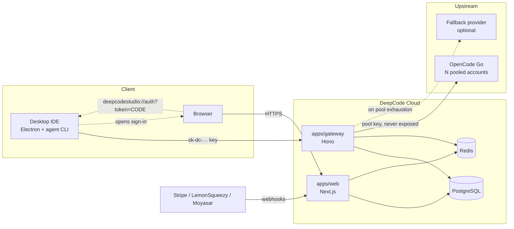
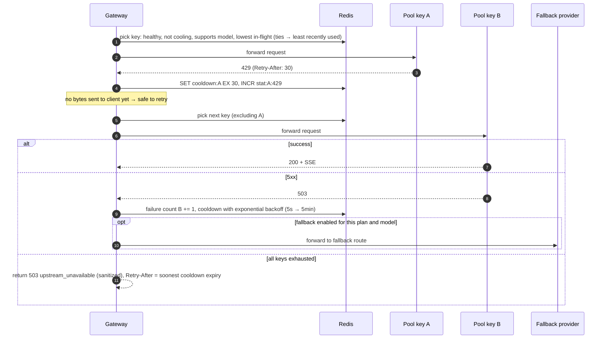

# 00 — Master Architecture

**Project:** DeepCode Studio (ديب كود استوديو)
**Status:** Proposed — awaiting approval. No production code has been written.
**Date:** 2026-11-14
**Upstream base:** `axiom-desu/ZCodium` @ `e5346dec` (v3.16.2, Apache-2.0), cloned to `apps/desktop`.

---

## 0. Read this first: three findings that change the brief

These came out of the audit and need a decision before Phase 1.

| # | Finding | Consequence |
|---|---------|-------------|
| **F1** | **Reselling pooled OpenCode Go subscriptions.** ~~Very likely outside its terms.~~ **Resolved 2026-11-14:** the project owner confirmed that OpenCode's terms permit this use. | OpenCode Go is the primary upstream for launch. The gateway stays **upstream-agnostic** anyway (OpenCode Go is one `upstream_provider` row), because supplier terms, prices and limits can change. See ADR-001. |
| **F2** | **OpenCode Go is not one API. It is four.** ZCodium's built-in provider config ships four Go templates: OpenAI Chat Completions, Anthropic Messages, OpenAI Responses (all at `https://opencode.ai/zen/go/v1`) and Google Generative AI (`https://opencode.ai/inference/go/google/v1beta`). 26 models are split across them. | `stream_options.include_usage` only exists on Chat Completions. The gateway needs **four protocol adapters**, each with its own usage parser. Doc 02 specifies all four. |
| **F3** | **A long-lived token in `deepcodestudio://auth?token=...` is unsafe.** Custom URL schemes can be claimed by any local app, and the URL lands in OS logs and browser history. | The deep link keeps the requested shape but carries a **single-use, 60-second authorization code** bound to a PKCE verifier held only by the desktop app. See §4.1. |

Other audit facts that shaped the plan:

- ZCodium has **already removed upstream telemetry** (`TELEMETRY_REMOVAL.md`: ARMS/RUM SDKs, device IDs, behaviour tracking, model I/O recording). What remains is service coupling to Z.ai, not telemetry. Doc 01 lists it.
- The desktop app is **not a single package**. It is a pnpm workspace of 15 packages plus a Node agent CLI (`apps/zcode-cli`, ~30 packages) and a Rust agent CLI (`apps/zcode-cli-rust`). Model requests are made by the agent CLI, not by the Electron renderer.
- It requires **Node ≥ 24 and pnpm 10.33.2**. This machine has Node 22.23 and pnpm 12.18, so a toolchain pin (mise/corepack) is a Phase 0 prerequisite.
- Brand strings are widespread: `zcode` appears in 3,444 source files, `ZCode` in 1,483, `ZCodium` in 169. The rebrand must be scripted and layered, not hand-edited.

---

## 1. Requirements

### Functional
- Desktop IDE: branded fork, Arabic (RTL) + English (LTR), browser sign-in, live quota HUD, local MCP + Skills, cloud-synced curated Skills/MCP presets.
- Gateway: virtual keys, per-plan model permissions, credit quotas, expiry, RPM limits, upstream key pool with failover, exact streaming token metering.
- Web portal: landing, downloads, checkout, client dashboard, admin panel.

### Non-functional (assumed targets — confirm)
| Attribute | Target for v1 |
|-----------|---------------|
| Gateway added latency (TTFB) | p50 < 15 ms, p99 < 50 ms over upstream |
| Streaming | Zero buffering; chunks forwarded as received |
| Availability | 99.9% gateway, single region to start |
| Scale | 2,000 subscribers, ~150 concurrent streams, ~40 RPS peak |
| Metering accuracy | 100% of completed streams metered; aborted streams estimated and flagged |
| Secret exposure | Upstream keys never leave the gateway process memory in plaintext |

### Constraints
- Apache-2.0 obligations on the fork: keep `LICENSE`, keep and extend `NOTICE.md`, mark modified files, do not use the ZCode/Z.ai names or logos as our own.
- Payment must work in MENA: Moyasar is the primary candidate; Stripe and LemonSqueezy stay pluggable.

---

## 2. Monorepo layout

`apps/desktop` keeps its own pnpm workspace and lockfile. Merging 45+ upstream packages into our root workspace would make every upstream merge a conflict. The root workspace owns only our code.

```
DeepCode Studio/
├── apps/
│   ├── desktop/                  # ZCodium fork — INDEPENDENT pnpm workspace (pnpm 10, Node 24)
│   │   ├── packages/desktop/     #   Electron main / preload / renderer / host / scheduler
│   │   ├── packages/ui/          #   React components, Zustand stores, i18n
│   │   ├── packages/shared/      #   protocol types, endpoint resolver, app-dir names
│   │   ├── packages/services/    #   credential, skills, usage-stats, model-provider
│   │   ├── packages/provider*/   #   provider registry + config
│   │   ├── packages/deepcode/    #   NEW — all DeepCode-specific desktop code lives here
│   │   ├── apps/zcode-cli/       #   Node agent runtime (MCP client, skills scan, model adapters)
│   │   └── apps/zcode-cli-rust/  #   Rust agent runtime
│   ├── gateway/                  # Hono on Node 24 — proxy, metering, pool
│   └── web/                      # Next.js App Router — landing, dashboard, admin
├── packages/
│   ├── shared/                   # @deepcode/shared — zod contracts, constants, error codes
│   ├── db/                       # @deepcode/db — Drizzle schema, migrations, seed
│   └── config/                   # tsconfig, lint and tailwind presets
├── docs/plan/                    # this blueprint
├── infra/                        # docker-compose (pg, redis), Dockerfiles, CI
├── pnpm-workspace.yaml           # apps/gateway, apps/web, packages/*  (NOT apps/desktop)
└── turbo.json
```

**How the desktop consumes `@deepcode/shared`:** `packages/shared` builds to a dependency-free ESM bundle. A script copies it into `apps/desktop/packages/deepcode/vendor/contracts`. The desktop workspace never reaches outside its own root, so upstream tooling (architecture checks, knip, gate ratchets) keeps working.

**Upstream tracking:** `apps/desktop/.git` currently points at ZCodium. In Phase 3 it becomes a `git subtree` of the root repo with `upstream` kept as a remote, so we can pull upstream fixes. All DeepCode changes are confined to (a) a brand-identity layer, (b) `packages/deepcode`, and (c) a short, documented list of patched upstream files (doc 01 §9).

---

## 3. System context



**Ownership rules (one writer per fact):**

| Data | Single writer | Readers |
|------|---------------|---------|
| Users, sessions, plans, subscriptions | `apps/web` | gateway (read, cached 30 s) |
| Virtual keys | `apps/web` (create/rotate/revoke) | gateway (validate) |
| Credits used, usage logs | `apps/gateway` | web (charts) |
| Upstream pool keys | `apps/web` admin (CRUD), gateway (health fields only) | gateway |
| Rate-limit counters, cooldowns, in-flight counts | `apps/gateway` in Redis | web admin (read) |

---

## 4. Sequence diagrams

### 4.1 Desktop deep-link authentication

```mermaid
sequenceDiagram
  autonumber
  participant D as Desktop (main process)
  participant B as System browser
  participant W as Web portal
  participant PG as PostgreSQL

  D->>D: generate state (128-bit) + code_verifier, compute code_challenge = S256(verifier)
  D->>B: open https://deepcodestudio.com/auth/desktop?state&code_challenge&device_name&os
  B->>W: GET /auth/desktop (user signs in if no session)
  W->>B: consent screen "Connect DeepCode Studio on <device>?"
  B->>W: POST approve
  W->>PG: insert desktop_auth_codes(code_hash, user_id, state, code_challenge, expires_at = now()+60s)
  W->>B: 302 deepcodestudio://auth?token=<one-time code>&state=<state>
  B->>D: OS delivers deep link (second-instance / open-url)
  D->>D: verify state matches pending request, else drop silently
  D->>W: POST /api/desktop/exchange {code, code_verifier, device fingerprint}
  W->>PG: atomically consume code (single use), verify S256(verifier) == challenge
  W->>PG: create virtual_api_keys(kind='desktop', device_id) and device row
  W-->>D: { apiKey: "sk-dc-…", user, plan, gatewayBaseUrl }
  D->>D: store apiKey with Electron safeStorage; register provider "account:deepcode"
  D->>D: start HUD polling
```

Notes:
- The code in the URL is useless without the verifier, which never leaves the desktop process.
- The desktop holds **one credential**: a device-scoped virtual key. It authenticates model traffic, `/v1/subscription/status` and the Skills/MCP sync endpoints. Revoking a device in the dashboard revokes that key.
- ZCodium already has the plumbing: `desktopOAuthDeepLink.ts`, `desktopSecondInstanceDeepLink.ts`, `desktopLinuxDeepLinkRegistration.ts`, and `protocols` in `electron-builder.config.js`. We change the scheme and the handler, not the mechanism.

### 4.2 Streaming chat + token metering

```mermaid
sequenceDiagram
  autonumber
  participant C as Desktop agent CLI
  participant G as Gateway
  participant R as Redis
  participant PG as PostgreSQL
  participant U as OpenCode Go

  C->>G: POST /v1/chat/completions (Bearer sk-dc-…, stream:true)
  G->>R: GET key:{sha256} (auth snapshot, 30 s TTL)
  alt cache miss
    G->>PG: load key + subscription + plan
    G->>R: SET key:{sha256}
  end
  G->>G: check status, expires_at, model allowed, credits_remaining > 0
  G->>R: sliding-window RPM check (Lua, atomic)
  G->>R: reserve estimated credits + INCR in-flight for chosen pool key
  G->>U: forward with pool key, inject stream_options.include_usage=true
  U-->>G: 200 + SSE
  G-->>C: 200 + headers X-Credits-Remaining / X-Usage-Percentage / X-Subscription-Expires / X-Plan-Name
  loop each chunk
    U-->>G: data: {...}
    G-->>C: same bytes, forwarded immediately
    G->>G: tee to usage parser (no await on the hot path)
  end
  U-->>G: final usage chunk, then [DONE]
  G-->>C: (usage chunk dropped if client did not ask for it) + ": deepcode-usage {json}" comment + [DONE]
  G->>PG: one transaction: UPDATE subscriptions SET credits_used += cost; INSERT usage_logs
  G->>R: release reservation, DECR in-flight, invalidate key snapshot
```

Notes:
- Headers are sent before the stream, so they report the balance **before** this request. The exact post-request balance travels in an SSE comment line (`: deepcode-usage {...}`). SSE parsers ignore comment lines by specification, so third-party clients are unaffected, and our desktop reads it to update the HUD without a second round trip.
- The Postgres write happens after the client has its last byte. It adds no latency to the response.

### 4.3 Upstream key pool failover



Rule: **retry only before the first byte reaches the client.** A stream that fails midway is closed with a terminal error event, metered for what was delivered, and not retried, because replaying would duplicate tool calls.

---

## 5. Shared TypeScript contracts (`@deepcode/shared`)

Zod schemas are the source of truth; types are inferred. Signatures only — implementation comes in Phase 1.

```ts
// identifiers
export const VIRTUAL_KEY_PREFIX = "sk-dc-";
export const DEEP_LINK_SCHEME = "deepcodestudio";

export type PlanTier = "free" | "starter" | "pro" | "team";
export type SubscriptionStatus = "trialing" | "active" | "past_due" | "canceled" | "expired";
export type UpstreamApiType =
  | "openai-chat-completions" | "anthropic-messages"
  | "openai-responses"        | "google-generative-ai";

// GET /v1/subscription/status
export interface SubscriptionStatusResponse {
  plan: { id: string; tier: PlanTier; name: { en: string; ar: string } };
  status: SubscriptionStatus;
  credits: { limit: number; used: number; remaining: number; percentUsed: number };
  period: { startsAt: string; expiresAt: string; daysLeft: number };
  limits: { rpm: number; allowedModels: string[] };
  lock: null | { reason: "quota_exhausted" | "expired" | "suspended" | "payment_failed"; renewUrl: string };
  serverTime: string;
}

// trailing SSE comment payload
export interface StreamUsageNotice {
  requestId: string;
  model: string;
  tokens: { input: number; output: number; cachedInput: number; reasoning: number };
  creditsCharged: number;
  creditsRemaining: number;
  percentUsed: number;
  estimated: boolean;
}

// every non-2xx gateway response
export interface GatewayError {
  error: {
    code:
      | "invalid_api_key" | "key_revoked" | "subscription_expired" | "quota_exhausted"
      | "model_not_allowed" | "rate_limited" | "upstream_unavailable" | "bad_request" | "internal";
    message: string;      // safe, localizable; never contains upstream text
    requestId: string;
    renewUrl?: string;
  };
}

// response headers, single definition used by gateway and desktop
export const USAGE_HEADERS = {
  creditsRemaining: "X-Credits-Remaining",
  usagePercentage: "X-Usage-Percentage",
  subscriptionExpires: "X-Subscription-Expires",
  planName: "X-Plan-Name",
  requestId: "X-Request-Id",
} as const;

// cloud sync
export interface SyncManifest {
  revision: number;
  skills: Array<{ id: string; name: string; version: string; sha256: string; url: string; minTier: PlanTier }>;
  mcpPresets: Array<{ id: string; name: string; version: string; minTier: PlanTier; config: McpPresetConfig }>;
}
```

---

## 6. Environment variable matrix

`S` = server secret, `P` = public (safe in a client bundle), `B` = build-time.

| Variable | gateway | web | desktop | Class | Notes |
|----------|:-:|:-:|:-:|:-:|-------|
| `DATABASE_URL` | ✓ | ✓ | | S | Separate DB roles: gateway cannot write `users`/`plans` |
| `REDIS_URL` | ✓ | ✓ | | S | |
| `POOL_KEY_ENCRYPTION_KEY` | ✓ | ✓ | | S | 32-byte AES-256-GCM key; web encrypts on admin create, gateway decrypts. KMS in production |
| `KEY_HASH_PEPPER` | ✓ | ✓ | | S | HMAC pepper for virtual-key hashing |
| `AUTH_SECRET` | | ✓ | | S | Session signing |
| `STRIPE_SECRET_KEY` / `STRIPE_WEBHOOK_SECRET` | | ✓ | | S | Optional |
| `LEMONSQUEEZY_API_KEY` / `LEMONSQUEEZY_WEBHOOK_SECRET` | | ✓ | | S | Optional |
| `MOYASAR_SECRET_KEY` / `MOYASAR_WEBHOOK_SECRET` | | ✓ | | S | Optional |
| `BILLING_PROVIDER` | | ✓ | | S | `stripe` \| `lemonsqueezy` \| `moyasar` |
| `GATEWAY_INTERNAL_TOKEN` | ✓ | ✓ | | S | web → gateway cache invalidation calls |
| `UPSTREAM_REQUEST_TIMEOUT_MS` | ✓ | | | S | Default 120000 |
| `LOG_LEVEL` | ✓ | ✓ | | S | |
| `NEXT_PUBLIC_SITE_URL` | | ✓ | | P | |
| `NEXT_PUBLIC_GATEWAY_URL` | | ✓ | | P | Shown in the dashboard |
| `NEXT_PUBLIC_RELEASES_BASE_URL` | | ✓ | | P | Installer CDN |
| `DEEPCODE_WEB_ORIGIN` | | | ✓ | B/P | Replaces `ZCODE_BASE_URL` |
| `DEEPCODE_GATEWAY_URL` | | | ✓ | B/P | Baked into the built-in provider config |
| `DEEPCODE_UPDATE_ORIGIN` | | | ✓ | B/P | Replaces `ZCODIUM_UPDATE_ORIGIN` |
| `DEEPCODE_ENV` | | | ✓ | B | `production` \| `test` |
| Signing: `APPLE_*`, `CSC_*`, `WIN_CSC_*` | | | CI only | S | Never in the repo |

**Hard rule:** no upstream OpenCode key is ever an environment variable of `apps/web` or `apps/desktop`. They exist only as encrypted rows, decrypted inside the gateway process.

---

## 7. Architecture decisions

### ADR-001: Upstream supply is abstracted, not hard-wired to OpenCode Go
**Status:** Proposed. **Deciders:** you.
**Context:** F1 above. A single supplier that can ban accounts is an existential dependency.
**Decision:** Model upstream as `upstream_providers` (base URL, API types, auth scheme) plus `upstream_pool_keys`. Routing is `model → ordered list of (provider, upstream model id)`.
**Options:**

| | A: OpenCode Go only | B: Abstracted providers (chosen) |
|-|-|-|
| Complexity | Low | Medium (one extra table, one routing table) |
| Supplier risk | Total | Switch by data change |
| Margin | Highest while it lasts | Lower on pay-as-you-go routes |

**Consequences:** Slightly more schema now; losing a supplier becomes an incident, not a shutdown. **Resolved 2026-11-14:** owner confirmed OpenCode's terms permit pooled resale; OpenCode Go is the launch upstream, and a fallback provider remains optional per plan.

### ADR-002: Gateway is Hono on Node 24, not Next.js route handlers
**Context:** Long-lived SSE streams, per-request Redis and connection pooling, strict control over buffering.
**Decision:** Standalone Hono service on `@hono/node-server`, `undici` for upstream with a keep-alive pool per upstream origin.
**Trade-off:** One more deployable, but streaming behaviour is under our control and the gateway scales independently of the website. Bun or a Rust rewrite stays possible later because the surface is small.

### ADR-003: Drizzle over Prisma
**Decision:** Drizzle ORM. The hot path needs hand-written atomic SQL (`UPDATE … RETURNING`), which Drizzle expresses directly, and it has no query-engine binary to ship.

### ADR-004: Credits are the billing unit; tokens are the evidence
**Decision:** 1 credit = USD 0.000001 of list-price cost. Each model has input, cached-input and output prices per million tokens in `model_prices`. Plans grant a credit allowance per period. Usage logs store raw token counts **and** the charged credits, so repricing never rewrites history.

### ADR-005: Desktop auth yields a device-scoped virtual key
**Decision:** As in §4.1. One credential on the device, revocable per device, no refresh-token machinery in the Electron app.
**Trade-off:** The key is long-lived on disk (encrypted by OS keychain via `safeStorage`). Mitigated by per-device revocation and anomaly alerts on concurrent-IP use.

### ADR-006: Virtual keys are shown once
**Context:** The brief asks for both SHA-256 hashing and a "reveal" button. A hashed key cannot be revealed.
**Decision:** Store `HMAC-SHA256(pepper, key)`, plus prefix and last four characters for display. The full key is shown once at creation and on rotation. The dashboard "reveal" control becomes "rotate and show". If you want true reveal, the alternative is storing an AES-GCM-encrypted copy, which weakens the guarantee; I recommend against it.

---

## 8. What to revisit as the system grows

- Multi-region gateway: Redis becomes the consistency point; move rate limiting to a regional store and reconcile credits asynchronously.
- `usage_logs` volume: monthly partitions from day one; roll up to `usage_daily` for charts; archive after 13 months.
- Team plans: `organizations` and seat-level keys are schema-ready but out of scope for v1.
- Rust agent runtime: v1 ships the Node agent runtime; the Rust runtime needs the same endpoint and header patches before it can be enabled (doc 01 §3).
