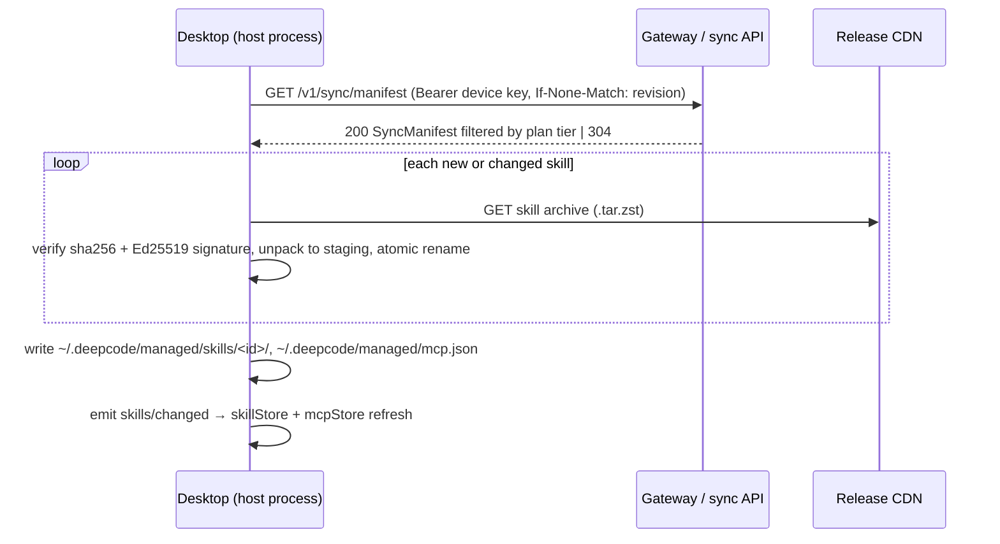

# 01 — ZCode Rebrand and IDE Features

**Status:** Proposed. **Base:** ZCodium v3.16.2 @ `e5346dec` in `apps/desktop`.
All paths below are relative to `apps/desktop/`. File paths come from the clone and hit counts from the audit on 2026-11-14. The audit read manifests, configs and file listings and grepped for hosts and brand strings; it did not trace every call path. Two attributions are inferred from file names and still need confirming when the code is opened in Phase 3: that `desktopMcpTelemetry.ts` is the caller of `/api/v1/mcp/usage`, and where the renderer splash markup lives. The fork has not been installed or built yet.

---

## 1. Audit summary

| Area | What exists upstream | Where |
|------|---------------------|-------|
| Toolchain | Node ≥ 24, pnpm 10.33.2, TypeScript 6, Vite 8, tsup, Electron Builder, oxlint/oxfmt, turbo | `package.json`, `mise.toml` |
| Workspace | 15 packages + Node agent CLI (~30 packages) + Rust agent CLI | `pnpm-workspace.yaml` |
| Electron | main / preload / renderer / host / scheduler processes | `packages/desktop/src/*` |
| UI | React 19, Zustand stores, shadcn-style components, Tailwind | `packages/ui/src` (648 `.tsx` files) |
| State | ~40 Zustand stores | `packages/ui/src/store/` |
| i18n | Custom `ZCodeIntlProvider`; two locales, ~6,500 keys each | `packages/ui/src/i18n/`, `apps/zcode-cli/packages/i18n/` |
| Providers | Registry + rule-based built-in config (22 templates, 8 account providers, 84 model rules) | `packages/provider*`, `config/provider/zcode-builtin.json` |
| MCP client | stdio + SSE/HTTP transports in the agent CLI | `apps/zcode-cli/packages/adapters/src/mcp/` |
| Skills | `SKILL.md` scan, frontmatter parse, discovery order | `apps/zcode-cli/packages/adapters/src/skills/`, `packages/services/src/skills/` |
| Plugins | Marketplace + bundled official plugins | `packages/shared/src/plugin-marketplaces.ts`, `apps/zcode-cli/packages/*-plugin` |
| Auth | Z.ai OAuth over deep link, credentials in `safeStorage` | `packages/desktop/src/main/desktopOAuthDeepLink.ts`, `packages/services/src/credential/credentialService.ts` |
| Quota UI | Coding Plan quota panel in Settings | `packages/ui/src/settings/usage-stats/CodingPlanQuotaPanel.tsx`, `packages/services/src/usage-stats/codingPlanQuota.ts` |
| Updates | Manifest-based updater, skipped when no update origin is set | `packages/desktop/src/main/autoUpdater.ts`, `manifestUpdateProvider.ts` |
| Product identity | Single source for appId / productName / Linux names | `packages/desktop/scripts/desktop-product-identity.mjs` |
| Data directories | Single source for all on-disk names | `packages/shared/src/appDirNames.ts` |
| Endpoints | Single resolver for all first-party origins | `packages/shared/src/zcodeEndpoint.ts` |

The last three rows matter most: upstream already centralised identity, directory names and endpoints. Most of the rebrand is changing three files and letting the build propagate.

---

## 2. Rebrand map

### 2.1 Layer 1 — identity constants (hand-edited, ~10 files)

| File | Change |
|------|--------|
| `packages/desktop/scripts/desktop-product-identity.mjs` | `PRODUCTION_IDENTITY`: `appId: "com.deepcodestudio.ide"`, `productName: "DeepCode Studio"`, `linuxExecutableName`/`linuxPackageName: "deepcode-studio"`. `PREVIEW_IDENTITY`: `com.deepcodestudio.ide.preview`, `DeepCode Studio Preview`, `deepcode-studio-preview` |
| `packages/shared/src/appDirNames.ts` | `.zcodium-exp` → `.deepcode`; workspace dir `.zcodium` → `.deepcode`; `zcodium.json` → `deepcode.json`; `.zcodiumignore` → `.deepcodeignore`; plugin manifest dir `.zcodium-plugin` → `.deepcode-plugin` (keep `.claude-plugin`/`.codex-plugin` compatibility readers). Remove the legacy-migration constants; there is nothing to migrate from |
| `packages/shared/src/zcodeEndpoint.ts` | See §3 |
| `packages/shared/src/env.ts` | `ZCODIUM_UPDATE_ORIGIN` → `DEEPCODE_UPDATE_ORIGIN`; keep the "empty origin skips update check" behaviour |
| `packages/desktop/electron-builder.config.js` | `protocols[0].schemes: ["deepcodestudio"]`; `WINDOWS_INSTALL_MANIFEST_NAME`; default Electron mirror `npmmirror.com` → official; `extendInfo` usage strings; signing-ignore path `Resources/glm` renamed with the runtime folder |
| `packages/desktop/package.json` | `description`, `author` |
| `package.json` (root of fork) | `name` only; keep `@zcode/*` package scopes (see §2.4) |
| `config/default.json` | `feedback_url`, `community_urls` → our URLs, add `"ar"` key |
| `packages/shared/src/openrouter-attribution.ts` | Title `ZCodium` → `DeepCode Studio` (only relevant if BYOK stays, §4) |
| `packages/desktop/dev-app-update.yml` | `updaterCacheDirName` |

### 2.2 Layer 2 — assets (replace files, same names)

| Path | Asset |
|------|-------|
| `packages/desktop/build/icon.icns`, `icon.ico`, `icon.png`, `icon_linux.png`, `icon_windows.png`, `icons/*` | App icon set (1024 px master, generated sizes) |
| `packages/desktop/build/icon_installer.*` | Installer icon |
| `packages/desktop/build/dmg_background.png`, `dmg_background@2x.png` | DMG background |
| `packages/desktop/build/installer.nsh` | NSIS strings and registry keys |
| `packages/ui/src/assets/*` | In-app logo, wordmark, empty-state art, provider logos |
| `public/*`, `docs/assets/*` | Favicons, share images |
| Splash / launch screen | Renderer `index.html` inline splash in `packages/desktop/src/renderer/` |

Deliverable needed from you: a logo master (SVG). Until then a placeholder wordmark is used.

### 2.3 Layer 3 — user-visible strings (scripted)

- All UI copy flows through the locale files. A codemod rewrites `ZCodium Exp`, `ZCodium`, `ZCode`, `Z Code`, `Z.ai`-branded product copy in `packages/ui/src/i18n/locales/*.ts` and `apps/zcode-cli/packages/i18n/src/locales/*.ts`.
- A second pass finds brand literals outside locale files in `.tsx` and main-process dialogs (About window `about.ts`/`aboutWindow.ts`, tray `desktopTray.ts`, application menu `desktopApplicationMenu.ts`, notification titles, window titles in `desktopWindowChrome.ts`).
- Request headers that leak the upstream brand: `X-Title: "Z Code@…"`, `HTTP-Referer`, `User-Agent` in `apps/zcode-cli-rust/crates/net/src/headers.rs` and the Node equivalent under `apps/zcode-cli/packages/adapters/src/model/`. Set to `DeepCode Studio/<version>`.
- A CI check (`scripts/ci/brand-leak-check.mjs`, new) fails the build if a user-visible string or packaged resource contains `zcode`, `zcodium`, `z.ai`, `bigmodel` or `智谱`, with an allowlist for licence files and internal identifiers.

### 2.4 What is deliberately **not** renamed

Internal identifiers stay: `@zcode/*` package scopes, the `zcode-protocol` module, type names such as `ZCodeEnv`, IPC channel names, the `window.zcode` preload bridge, and `ZCODE_*` internal env variables. `zcode` appears in 3,444 source files. Renaming internals gains nothing for users and makes every upstream merge conflict. The brand-leak check enforces that none of these reach the UI or the installer.

### 2.5 Apache-2.0 compliance

- Keep `LICENSE` unchanged. Keep `NOTICE.md` and `THIRD-PARTY-NOTICES.md`; add a "DeepCode Studio modifications" section stating the fork origin and that files were changed.
- Remove ZCode/Z.ai logos and names from all branding surfaces. Do not imply endorsement.
- The About window lists "Based on ZCodium (Apache-2.0)" with a link to the notices.

---

## 3. Removing upstream services

Telemetry SDKs are already gone upstream. The remaining network coupling, found by grepping first-party sources:

| Coupling | Evidence | Action |
|----------|----------|--------|
| Product API `https://zcode.z.ai` (client configs, conversation share, release manifest, MCP usage reporting `/api/v1/mcp/usage`) | `packages/shared/src/zcodeEndpoint.ts`, `packages/desktop/src/main/manifestUpdateProvider.ts`, `desktopMcpTelemetry.ts` | Default origin → `DEEPCODE_WEB_ORIGIN`. Implement `/api/v1/client/configs` and `/api/v1/releases/electron/manifest` in `apps/web`. **Delete** the MCP usage reporter and conversation-share upload (feature-flag off; share can return later on our backend) |
| Z.ai OAuth `https://chat.z.ai`, client id `client_P8X5…` | `zcodeEndpoint.ts`, `packages/shared/src/oauth.ts`, `.env.example` | Remove provider ids `zai`/`bigmodel`; replace with DeepCode auth (§6) |
| Z.ai business API `https://api.z.ai`, BigModel `https://open.bigmodel.cn` | `zcodeEndpoint.ts`, `packages/shared/src/model-provider-family.ts`, `packages/services/src/model-provider/legacyZCodeConfigProviderReader.ts` | Remove account-provider families and the legacy reader |
| Coding Plan gateway rewrite (`/api/v1/ultra/…`) | `apps/zcode-cli-rust/crates/net/src/gateway.rs`, Node `adapters/src/model/official-coding-plan-gateway.ts` | Delete both route tables |
| CDN `https://cdn-zcode.z.ai` for remote runtime assets | `.env.example`, `packages/shared/src/remoteResourcePackages.ts`, `bundledRemoteAssets.ts` | Bundle assets in the installer (`verifyBundledRemoteAssets` path already exists); point any remaining remote fetch at our release CDN |
| Electron mirror `npmmirror.com`, npm registry mirror | `electron-builder.config.js`, `.npmrc` | Official sources |
| Feishu / Lark / WeChat bot integrations | `@larksuiteoapi/node-sdk` forced into the asar, `packages/shared/src/bots*`, `ilinkai.weixin.qq.com` | Remove from v1 (feature off, dependency dropped, asar injection entry removed). Telegram/Slack bots can be added later if wanted |
| Alibaba Model Studio / DashScope console links | provider templates | Removed with the templates |
| `X-Title` / `HTTP-Referer` attribution headers | `headers.rs`, `openrouter-attribution.ts` | Rebrand (§2.3) |

**Verification:** an integration test launches the packaged app behind a recording proxy with a fresh profile and asserts the set of contacted hosts is a subset of `{DEEPCODE_WEB_ORIGIN, DEEPCODE_GATEWAY_URL, DEEPCODE_UPDATE_ORIGIN}` plus hosts the user configured (MCP servers, git remotes).

**Agent runtime choice.** The production flavour uses the Node agent runtime; the preview flavour defaults to Rust. v1 ships production flavour with the Node runtime only. The Rust runtime is excluded from the build until `headers.rs` and `gateway.rs` carry the same patches and pass the same host-allowlist test.

---

## 4. Provider layer: one built-in provider

`config/provider/zcode-builtin.json` (187 KB, revision 40) is rule-driven. We replace it with `config/provider/deepcode-builtin.json`, generated at build time from a small source file.

- **Remove** all 8 `account:zai-*` / `account:bigmodel-*` provider rules and their 26 built-in model rules.
- **Add** one account provider:

```jsonc
{
  "providerId": "account:deepcode",
  "providerName": "DeepCode Studio",
  "config": {
    "group": "deepcode",
    "access": { "type": "deepcode-account" },          // new access type
    "api": { "type": "openai-chat-completions", "baseUrl": "${DEEPCODE_GATEWAY_URL}/v1" },
    "logo": { "type": "builtin", "key": "deepcode" }
  }
}
```

- The upstream registry binds one API type per provider entry, so the gateway's four protocol surfaces are exposed as four internal entries (`account:deepcode`, `:messages`, `:responses`, `:google`) presented in the UI as a **single** "DeepCode Studio" provider. The model list comes from `limits.allowedModels` in the subscription status, so the picker shows exactly what the plan permits.
- Keep the generic model capability rules (`modelRules`, `modelApiRules`) for the models we serve; they carry context-window and reasoning-option metadata.
- **BYOK decision (yours):** the 22 third-party templates (OpenAI, Anthropic, OpenRouter, OpenCode, …) can be (a) removed, which makes the subscription the only way to use the app, or (b) kept behind an "Advanced → Custom providers" section. Recommendation: **(b), hidden by default**. It costs nothing, and developers distrust IDEs that forbid their own keys. The brief says "removal of default external providers", which (b) satisfies: none is enabled or shown by default.

New access type `deepcode-account` in `packages/shared/src/model-provider-types.ts`: the API key is not typed by the user; `account-provider-service.ts` reads it from the credential service entry written by the auth flow.

---

## 5. Bilingual UI with RTL/LTR isolation

### 5.1 Current state
- `Locale = "zh-CN" | "en-US"`; messages are flat `Record<string, string>` with `{placeholder}` substitution. No plural or bidi support. No `dir` handling anywhere.
- Tailwind physical-direction classes (`ml-`, `pr-`, `left-`, `text-left`, `border-l`, `rounded-r` …): **451 hits**. Logical classes: 22 hits.

### 5.2 Locale model
- `Locale = "ar" | "en-US"`, default from OS language, fallback `en-US`. `zh-CN` stays in the source tree as the upstream merge anchor but is removed from the switcher and from the shipped bundle.
- `ar.ts` is authored by translating `en-US.ts` (~6,500 keys). Machine draft, then human review of the top-traffic surfaces (chat, settings, HUD, onboarding, errors). A CI test asserts key parity between `ar` and `en-US` and that placeholders match.
- `IntlProvider` gains: `dir` derived from locale, `Intl.NumberFormat`/`DateTimeFormat`/`RelativeTimeFormat`/`PluralRules` helpers, and ICU-style plural selection for the handful of count strings (Arabic has six plural categories).
- Numerals: Western digits (`0-9`) in both locales via `numberingSystem: "latn"`. Token counts, prices and keys must be copy-pasteable.

### 5.3 Direction architecture

```
<html lang dir>                      ← set by IntlProvider (ar → rtl)
└─ app shell (mirrors)               sidebar side, panes, toolbars, menus, dialogs
   ├─ <LtrIsland> code editor        dir="ltr", unicode-bidi: isolate
   ├─ <LtrIsland> diff viewer
   ├─ <LtrIsland> terminal (xterm)
   ├─ <LtrIsland> file tree rows     path text only; the tree's indent side mirrors
   ├─ <LtrIsland> API keys, URLs, model ids, shell commands
   └─ <AutoDir> chat message body    dir="auto" per paragraph; code blocks forced LTR
```

- New primitives in `packages/ui/src/components/bidi/`: `LtrIsland` (`dir="ltr"` + `unicode-bidi: isolate` + `text-align: left`) and `AutoDir` (`dir="auto"`). A lint rule requires Monaco/CodeMirror hosts, xterm hosts, diff components and `<code>`/`<pre>`/`<kbd>` to sit inside `LtrIsland`.
- **File tree decision:** the brief says file trees stay strictly LTR. Implemented as: the tree container is an `LtrIsland`, so chevrons, indentation and names read exactly as in every other IDE, regardless of UI language.
- Codemod physical → logical classes: `ml→ms`, `mr→me`, `pl→ps`, `pr→pe`, `left→start`, `right→end`, `text-left→text-start`, `border-l→border-s`, `rounded-l→rounded-s`, plus `space-x-*` → `gap-*`. The 451 hits are reviewed by diff, because some are intentionally physical (drag handles, window-control placement, absolute overlays inside LTR islands).
- Directional icons (chevrons, arrows, "send") flip with `rtl:-scale-x-100`; non-directional ones (check, search, clock) do not.
- Window chrome: macOS traffic lights and Windows caption buttons stay where the OS puts them (`desktopWindowButtonPosition.ts`); only our own title-bar content mirrors.
- Lexical chat input (`LexicalChatInput.tsx`): paragraph direction auto-detected; mention chips and inline code are isolates.
- Fonts: `IBM Plex Sans Arabic` for Arabic UI, `Inter` for English UI, `JetBrains Mono` for code. Bundled as local `woff2` (no network font fetch in the desktop app). Arabic line-height is raised ~12% against the existing `text-ui-*` scale via a `:lang(ar)` rule on `--ui-line-height`, not by changing font sizes (upstream `DESIGN.md` forbids arbitrary sizes).

### 5.4 Acceptance scenarios
1. Switch to Arabic: shell mirrors without reload; an open editor, diff and terminal are pixel-identical to English.
2. A chat message mixing Arabic prose, an English identifier and a code block renders each run in the correct direction; copy-paste preserves logical order.
3. A file path with Arabic directory names displays in the tree and breadcrumb without reordering segments.
4. Visual regression (Playwright screenshots) on 12 key screens × 2 locales × 2 themes.

---

## 6. Authentication in the desktop app

Flow is in doc 00 §4.1. Desktop-side changes:

| File | Change |
|------|--------|
| `packages/desktop/src/main/desktopOAuthDeepLink.ts` | `handleDeepLink`: accept only `deepcodestudio://auth` and `deepcodestudio://workspace/open`. Auth handler validates `state` against the single pending request (in memory, 5-minute lifetime), then calls the exchange endpoint |
| `packages/desktop/src/main/desktopLinuxDeepLinkRegistration.ts`, `desktopSecondInstanceDeepLink.ts` | Scheme constant only |
| `packages/services/src/credential/credentialService.ts` | New entry `deepcode.deviceKey` (safeStorage-encrypted) |
| `packages/shared/src/oauth.ts` | Replace `zai`/`bigmodel` provider ids with `deepcode`; keep `UserInfo` |
| `packages/deepcode/src/auth/` (new) | `DeepCodeAuthService`: `startSignIn()`, `completeFromDeepLink(url)`, `signOut()`, `getSession()` |

Security points: the renderer never sees the key (main/host process attaches it); sign-out deletes the credential and calls `DELETE /api/desktop/device`; a `401 key_revoked` from the gateway triggers local sign-out and the sign-in screen.

---

## 7. Real-time Subscription & Usage HUD

### 7.1 Data sources (in priority order)
1. **Stream notice** — the `: deepcode-usage {json}` SSE comment after each response (exact, immediate).
2. **Response headers** — `X-Credits-Remaining`, `X-Usage-Percentage`, `X-Subscription-Expires`, `X-Plan-Name` on every gateway response (pre-request snapshot).
3. **Polling** — `GET /v1/subscription/status` on app start, on window focus, every 60 s while idle, and immediately after any gateway error with a lock code.

Sources 1 and 2 are captured in the agent runtime's model adapter (Node: `apps/zcode-cli/packages/adapters/src/model/`), emitted as a new protocol event `deepcode/usage-updated` (added to `packages/shared/src/zcode-protocol/index.ts` with a runtime validator, as upstream rules require), relayed by the host to the renderer.

### 7.2 Store — `packages/ui/src/store/subscriptionStore.ts`

```ts
type LockReason = "quota_exhausted" | "expired" | "suspended" | "payment_failed" | "signed_out";

interface SubscriptionState {
  status: "idle" | "loading" | "ready" | "error";
  snapshot: SubscriptionStatusResponse | null;   // server fact; never mutated locally except by merge
  receivedAt: number | null;                     // monotonic receipt time
  serverSkewMs: number;                          // serverTime − local clock, for countdown accuracy
  lock: { reason: LockReason; renewUrl: string } | null;
  lastError: string | null;

  applyStatus(s: SubscriptionStatusResponse): void;   // from polling
  applyUsageNotice(n: StreamUsageNotice): void;       // from stream; newer-wins by server time
  applyHeaders(h: UsageHeaderSnapshot): void;         // lowest priority; ignored if a newer notice exists
  setLockFromError(e: GatewayError["error"]): void;
  refresh(): Promise<void>;
  reset(): void;                                       // on sign-out
}

// selectors
selectPercentUsed, selectRemaining, selectDaysLeft, selectSeverity   // "ok" | "warn" (≥80%) | "critical" (≥95% or ≤3 days) | "locked"
```

Rules, following upstream conventions: one owner (this store), written only through the service hook `useSubscription()` in `packages/ui/src/hooks/`; multi-window sync through the existing broadcast service on channel `state:subscription` with a revision counter to prevent echo loops; `daysLeft` is **derived** from `expiresAt` and the skew-corrected clock, never stored.

### 7.3 Components — `packages/ui/src/subscription/`

| Component | Placement | Content |
|-----------|-----------|---------|
| `SubscriptionHudChip` | Sidebar footer, next to the existing usage menu item (`WorkspaceSidebarFooter.tsx`) | Plan name, thin progress bar, remaining credits (compact number), days left. Collapses to a ring + percentage when the sidebar is narrow |
| `SubscriptionHudPopover` | Opens from the chip | Plan name and tier badge; progress bar with used / limit; remaining balance; expiry date and countdown ("12 days left" / "متبقي ١٢ يومًا" rendered with Latin digits); RPM limit; buttons: Manage subscription (opens portal), Refresh |
| `SubscriptionLockModal` | App-level, rendered in `Root.tsx` | Blocking dialog on `lock != null`. Per-reason title, body and primary action (Renew / Upgrade / Update payment / Sign in). Secondary: "Use custom provider" when BYOK is enabled. Drafts in the composer are preserved |
| `ComposerQuotaNotice` | Above the chat input | Inline warning at ≥ 80% and ≥ 95%; replaces the send button's tooltip when locked |
| `SubscriptionSettingsPanel` | Settings → Usage, replacing `CodingPlanQuotaPanel` | Same data plus a link to the web dashboard's charts. Reuses `Progress`, `Button` and `formatCompactNumber` already in the codebase |

States every component handles: loading (skeleton, no layout shift), ready, stale (last update > 5 min and offline — shows "last updated" time), error (retry), signed-out.

Lock behaviour: when locked, the composer's submit is disabled at the service layer (`useZCodeTaskService`), not only in the UI, so queued and automated runs also stop. In-flight streams are allowed to finish. The lock clears automatically on the next successful status poll; the modal polls every 10 s while open so that paying in the browser unlocks the app without a restart.

Accessibility: progress uses `role="progressbar"` with `aria-valuenow`; severity is conveyed by icon and text, not colour alone; the modal traps focus and is dismissible only when the lock reason allows continued BYOK use.

Visual tokens: cyan `#06B6D4` for normal fill, amber `#F59E0B` at warn, red `#EF4444` at critical, mapped onto the upstream semantic token layer (doc 03 §1.4), using the mandatory `text-ui-*` scale.

---

## 8. MCP servers and Skills

### 8.1 Out of the box (already works upstream — we keep it)

- **Skills discovery order:** explicit roots → user `~/.deepcode/skills` → user `~/.agents/skills` → workspace `.deepcode/skills` → workspace `.agents/skills` → enabled plugin roots. First same-named skill wins. Scanner: `apps/zcode-cli/packages/adapters/src/skills/scan.ts`; UI: `skillStore.ts`.
- **MCP config:** user `~/.deepcode/cli/config.json` → `mcp.servers`, workspace `.deepcode/config.json`, with `.agents/mcp.json` (`mcpServers`) as fallback. Transports: stdio and SSE/streamable HTTP (`adapters/src/mcp/transport-factory.ts`). UI: `mcpStore.ts`, Settings → MCP.
- **Compatibility:** `~/.agents/skills` and `.agents/mcp.json` are shared conventions with other agents, so a user's existing skills appear on first launch. We also add `~/.claude/skills` as a read-only discovery root (low precedence).
- **Behaviour change to review:** upstream auto-connects workspace-scoped MCP servers on open. For a commercial product that is a supply-chain risk (cloning a repo can start arbitrary processes). Proposal: workspace-scoped servers require a one-time per-workspace trust prompt, keyed by a hash of the declaration, mirroring the existing workspace-hook trust mechanism.
- **Bundled plugins:** keep documents, pdf, presentations, spreadsheets, browser-use, skill-creator, plugin-creator, node-repl-host. Rebrand `zcode-guide` to a DeepCode guide. Drop `image-search` (depends on a Z.ai backend) unless we host an equivalent. Marketplace id `zcode-plugins-official` → `deepcode-official`.

### 8.2 Cloud sync of curated Skills and MCP presets



Design:
- **Separate managed root.** Synced content lives in `~/.deepcode/managed/`, added to the discovery order *after* user and workspace roots. User files are never overwritten, and a user skill with the same name shadows the managed one.
- **Integrity.** Each archive is hashed in the manifest and the manifest is signed with an Ed25519 key whose public half is compiled into the app. A compromised CDN cannot push a skill.
- **MCP presets are inert until enabled.** A preset is a template (`command`, `args`, required env names, description, icon). It appears in Settings → MCP under "DeepCode presets" with an Enable switch; enabling prompts for required secrets, which go to the credential service, not to the config file. Nothing a server pushes can start a process by itself.
- **Tier filtering** happens server-side; on downgrade, the next sync removes skills above the tier from the managed root.
- **Triggers:** sign-in, app start, every 6 h, and a manual "Sync now". Offline: the last synced set keeps working.
- **Service:** `packages/deepcode/src/sync/ManagedContentSyncService.ts`; state in `packages/ui/src/store/managedContentStore.ts`; reuses `packages/services/src/skill-sync/` primitives where they fit.

---

## 9. Packaging

| Platform | Targets | Notes |
|----------|---------|-------|
| Windows | NSIS `.exe` (x64, arm64) | `installer.nsh` rebrand; EV or OV code-signing certificate required to avoid SmartScreen warnings |
| macOS | `.dmg` + `.zip` (arm64, x64) | Developer ID signing + notarization; upstream already has a two-stage sign/notarize pipeline gated by `ZCODE_ENABLE_MAC_SIGN` |
| Linux | `.AppImage`, `.deb` (x64, arm64) | `ZCODE_DESKTOP_LINUX_TARGETS=AppImage,deb`; rpm/pacman optional later |

- Artifact names: `DeepCode-Studio-<version>-<os>-<arch>.<ext>`.
- Auto-update: implement `GET /api/v1/releases/electron/manifest` in `apps/web` (the provider upstream already expects), backed by a `releases` table and object storage. Channels: `stable`, `preview`.
- CI: adapt `.github/workflows/desktop.yml` into a matrix build on tag; signing secrets only in CI.

**Costs you need to budget:** Apple Developer Program (USD 99/yr) and a Windows code-signing certificate. Without them the installers work but show OS warnings.

---

## 10. Patched upstream files (the merge-conflict surface)

Kept deliberately short. Everything else is new files under `packages/deepcode/` or new components. As built (2026-11-15, `git diff e5346de..HEAD --stat` in apps/desktop):

1. `packages/desktop/scripts/desktop-product-identity.mjs` — appId/name/linux names
2. `packages/shared/src/appDirNames.ts` — `.deepcode` namespace; legacy migration constants removed
3. `packages/shared/src/zcodeEndpoint.ts` — DeepCode origins; ZAI/BIGMODEL exports removed; client-configs + release-manifest urls
4. `packages/shared/src/env.ts` — DEEPCODE_UPDATE_ORIGIN comment/compat
5. `packages/shared/src/protocol.ts` — `Locale = "ar" | "en-US"`, DEFAULT_LOCALE = ar
6. `packages/shared/src/validationAppSettings.ts` — locale enum/defaults
7. `packages/shared/src/desktopMenu.ts` — ar menu messages, DeepCode tray copy
8. `packages/provider/src/config/provider-data-schema.ts`, `provider-config.ts` — `deepcode-account` access type
9. `packages/provider/src/resolver.ts`, `account-provider-resolution.ts`, `sources.ts` — deepcode-account resolution
10. `packages/desktop/electron-builder.config.js` — deepcodestudio scheme, official mirror, install-manifest name
11. `packages/desktop/src/main/desktopOAuthDeepLink.ts`, `desktopDeepLinkUrl.ts`, `desktopLinuxDeepLinkRegistration.ts` — scheme only (auth routing added alongside)
12. `packages/desktop/src/main/desktopRuntimeEnv.ts` — ZAI_* env injection removed
13. `packages/desktop/vite.config.ts`, `tsup.config.ts` — DEEPCODE_UPDATE_ORIGIN injection
14. `packages/ui/src/i18n/IntlProvider.tsx`, `LocaleSwitcher.tsx` + locale files (ar added; zh-CN kept as anchor)
15. `apps/zcode-cli/packages/adapters/src/model/model-execution.ts` — deepcode-account key injection seam
16. `config/default.json`, `config/provider/deepcode-builtin.json` (generator: `scripts/codemod/generate-deepcode-builtin.mjs`)
17. Class-name codemod across `packages/ui/src` (`scripts/codemod/logical-classes.mjs`, re-runnable)
18. Brand-string codemod (`scripts/codemod/brand-strings.mjs`) + `scripts/ci/brand-leak-check.mjs`
19. Upstream service removal (§3): deleted zai/bigmodel oauth + account providers, coding-plan quota, MCP usage reporter, conversation share, bots, legacy config reader, CDN fetches — see the removal commit diff
